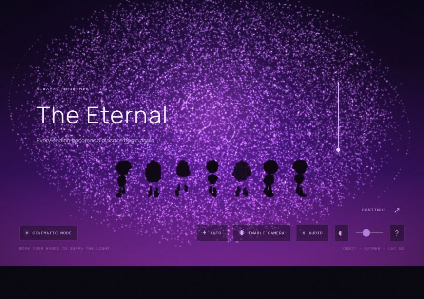
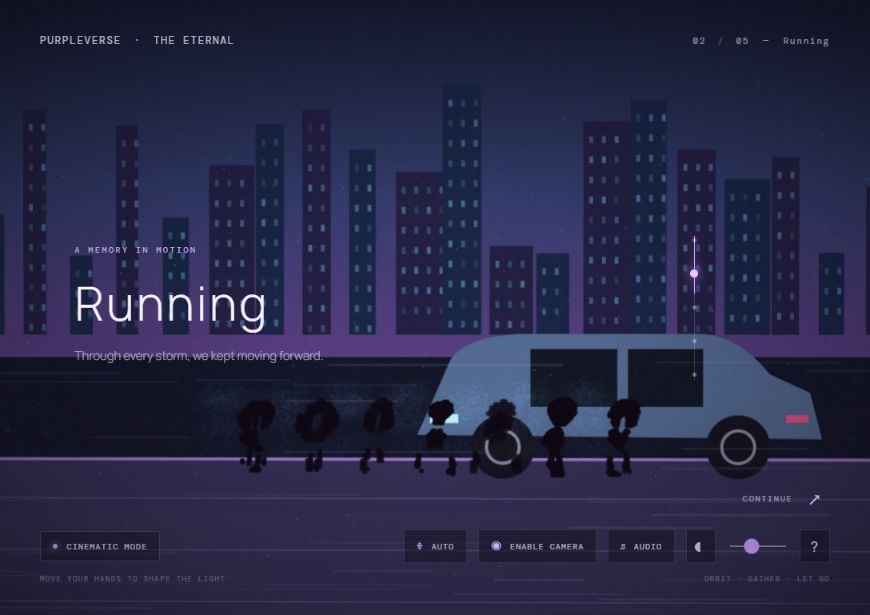
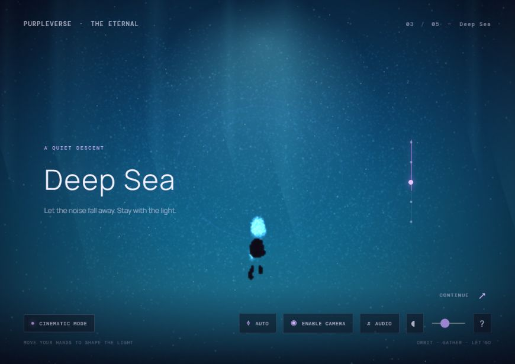
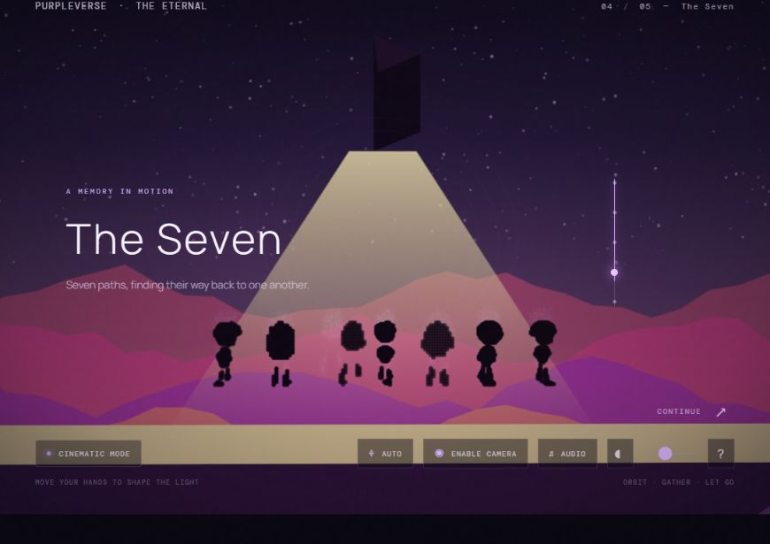

<div align="center">

# 💜 PURPLEVERSE — THE ETERNAL

### A little universe for the journey we shared.

An unofficial, interactive visual tribute to BTS and **“We Are Bulletproof: The Eternal.”**
Move through the memories, gather the light, and leave your own mark in the stars.

<p>
  <a href="https://purpleverse-orpin.vercel.app/"><strong>✦ &nbsp; ENTER PURPLEVERSE &nbsp; ↗</strong></a>
</p>

<p>
  
</p>

<p>
  
  
  
  
</p>

**Seven lights. One story. Always together.**

</div>

---

## ✨ The experience

PURPLEVERSE is a full-screen, five-chapter journey shaped around the feeling of *The Eternal*. A supplied 21-frame storyboard carries the scenes while a Three.js particle world gathers, scatters, and transforms between them. Follow the sequence at your own pace, or let it unfold automatically.

| Chapter | The moment |
| --- | --- |
| **01 · Awakening** | Seven silhouettes appear beneath a violet sky. |
| **02 · The Journey** | The memories begin to move. |
| **03 · Deep Sea** | A quiet descent into the blue. |
| **04 · The Seven** | Seven separate lights find one another again. |
| **05 · The Eternal** | The gathering opens into a universe of purple light. |
| **Epilogue · Air Writing** | Leave a violet trace in the starfield. |

<div align="center">

| The Journey | Deep Sea | The Seven |
|:---:|:---:|:---:|
|  |  |  |

</div>

## 🫶 Move with the light

### Hands

Choose **Enable Camera** when you’re ready. Camera access stays off until you turn it on.

| Gesture | Response |
| --- | --- |
| Open palm | Move to the next storyboard frame. |
| Fist | Dissolve forward. |
| Pinch | Draw nearby particles toward your hand. |
| Spread fingers | Send particles outward. |
| Move your hand | Steer the light field. |
| Bring both hands together or apart | Compress or expand the field. |
| Victory sign | Trigger a violet burst. |
| Index finger in the epilogue | Write in the air; lower it to pause. |

### Keyboard and pointer

- **← / →** — previous or next frame
- **Space** — advance
- **Pointer movement and click** — interact with the particle field
- Use the on-screen controls to play or pause the sequence.

### A little music, if you like

Load a local audio file from the audio control. No soundtrack is bundled with the project.

## 🚀 Run it locally

You’ll need Node.js and npm installed.

```bash
git clone https://github.com/metadore/purpleverse.git
cd purpleverse
npm install
npm run dev
```

Open the local address printed by Vite. Camera gestures require browser camera permission and are best used on `localhost` or a secure HTTPS origin. You can still explore the story with keyboard and pointer controls if you keep the camera off.

### Production build

```bash
npm run build
npm run preview
```

### Project checks

```bash
npm run test:storyboard
npm run test:gestures
```

## 🪄 Made with

- **React** and **Vite** for the experience and development workflow
- **Three.js** for the full-screen world, particles, and shader-driven transitions
- **GSAP** for scene motion
- **MediaPipe Tasks Vision** for optional hand tracking and air writing

The local hand-landmarker model is in `public/mediapipe/`. The ordered storyboard manifest lives in `src/data/`, and the scene and gesture code is organized under `src/scene/` and `src/gestures/`.

## 🌙 A note on the art

This version is a screenshot-led interactive tribute: the supplied frames are the main story artwork, with particles and transitions forming a surrounding world. The seven figures in the procedural particle layer are **not** member-specific character models. There are no bundled rigged characters, motion-capture clips, licensed soundtrack, or Rive animation file, so the project does not present those as finished features. The closing storyboard contains two identical supplied frames, retained in sequence.

The project is an **unofficial fan tribute**, not affiliated with or endorsed by BTS, BIGHIT MUSIC, or HYBE. BTS, the song, and related artwork belong to their respective rights holders.

---

<div align="center">

*When the night feels long, may you find your way back to your people.*

**보라해 · I purple you 💜**

</div>
